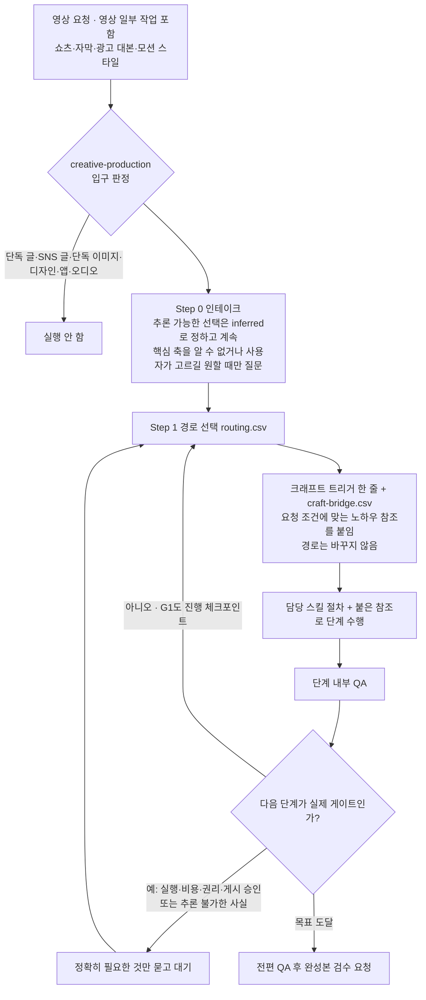
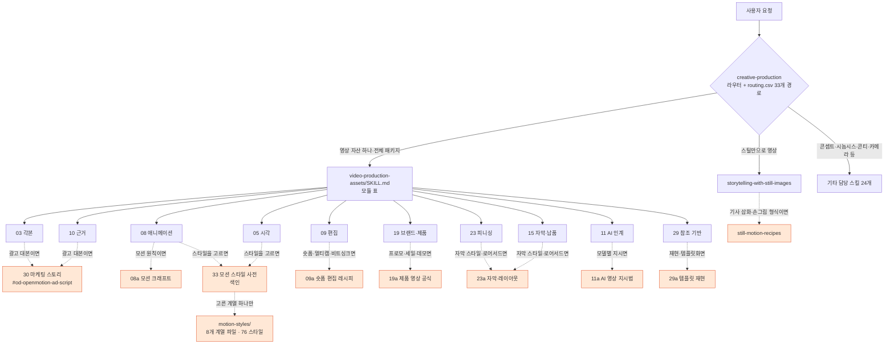
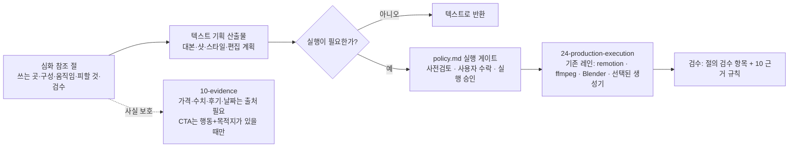
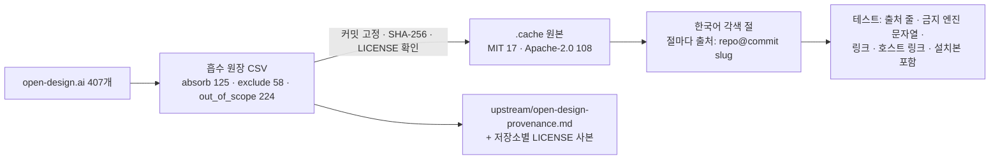

# contents-production-skills 2.63 작동 흐름

## 0. 논스톱 진행과 크래프트 브릿지 (2.63 최종)

## 1. 요청이 담당 스킬과 심화 참조에 닿는 길

주황 노드가 2.63에서 흡수한 open-design 크래프트다. 점선은 "조건이 맞을 때만 연다"는 조건부 링크다. 라우터(`creative-production`)와 `routing.csv`는 바뀌지 않았다.

## 2. 심화 참조를 읽은 뒤 실행까지

open-design 원본의 실행 엔진 호출(OpenMotion·HyperFrames 등)은 제거했다. 실행은 언제나 패키지 게이트를 거친다.

## 3. 출처 관리

